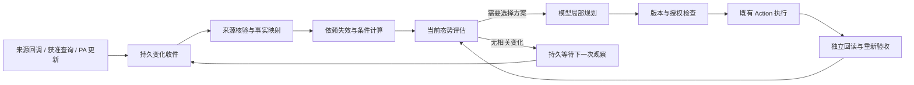

# 态势感知与持续履约：设计补充

日期：2026-10-25。状态：**设计与实施计划，尚未实现**。核查基线为 `64a034b`，运行合同 `ontology-execution-v22`、业务本体 `eigos.business@19`。本文补充[跨服务编排](cross-service-composition.md)、[单任务闭环](single-task-ontology-closure.md)和 [Ontology 规格](ontology-spec-v0.2-2026-10-18.md)，不替换现有执行内核。后续实现以实际分支重新核对接缝，本文不包含其他工作区的在途改动。

目标：在用户明确委托的观察期限内，接收现实变化，判断其对原目标及已选计划的影响，只调整受影响部分，并按当前证据和授权重新验收。业务步骤仍由模型根据 Ontology 选择；时间、版本、去重、依赖失效和授权检查由确定性代码处理。

本文交付不启动观察任务，不创建外部报名／日历，不变更服务权限或常驻部署。首轮实现验收采用合成来源；真实读取、日历写入及真实履约分别按实际授权和来源能力验收。真实下单、付款保持项目现有禁用边界。

## 1. 已有基础与准确缺口

| 基线已有机制 | 当前边界 | 本次设计补充 |
| --- | --- | --- |
| 来源回执、对象／关系摘要、时效及需求版本检查 | Action 观察必须属于既有 intent／attempt；通用入库不是供应商主动变化入口 | 独立变化收件、验证与当前事实映射 |
| `nextAt` 持久等待、领取、租约、取消和原操作恢复 | 没有用户目标级观察合同；默认任务总时限 24 小时，模型／计划／动作预算有限 | 有明确期限和成本的持续观察生命周期 |
| 2–4 个程序的组件图、类型化输出和主目标验收 | 组件完成后禁止其所有动作；下游只能激活一次；上游改变会拒绝旧结果，没有局部修复路径 | 组件代次、结果有效性、依赖失效与显式修复 |
| `OutcomeAssessment` 和历史反馈 | 评估表达验收时的结论，不自动刷新来源 | 当前态势评估及其输入依据，保留历史结果 |
| 准确计划许可和累计预算 | 许可绑定 `planDigest`，不能自动覆盖替代计划 | 区分观察权限、业务调整权限及逐次执行许可 |
| 报名、地点和滴滴估价 | 报名缺结构化地点；未见日历连接器；估价不证明接驾或到达 | 补最小活动关系、日历合同与有依据的时间计算 |

代码依据：[观察账本](../packages/core/store.ts)、[Agent 运行时](../packages/coordinator/agent-runtime.ts)、[组件执行器](../packages/coordinator/composition-program.ts)、[组件模型](../packages/ontology/composition.ts)、[精确授权](../packages/core/agent-authorization.ts)、[报名模型](../packages/ontology/free-booking.ts)、[能力目录](../packages/capabilities/catalog.ts)、[滴滴状态计算](../packages/ontology/ride-estimate-functions.ts)。

基线审查执行了 `tests/composition.test.ts`、`tests/action-runtime.test.ts`、`tests/goal-closure.test.ts`，31 项通过。这是已有行为的回归证据，不是本文新合同的验证结果。未核验部署或真实变化通知。

## 2. 运行职责与链路

- Gateway 只验证调用身份、接收获准更新、持久化和返回安全投影，不启动模型、供应商轮询或业务执行器。第一阶段只提供内部收件合同与测试入口，外部回调路由随具体来源合同另行接入，不预先开放通用匿名写入口。
- Connector 保留单次来源操作职责，并声明是否支持推送、当前状态读取、游标、原生版本及所需在线操作代理。不能用空适配器宣称来源可持续观察。
- Worker 复用 SQLite 领取和持久调度。观察、业务动作恢复和模型决策是不同工作类型，分别计量；调度器不选商家或自行拼业务步骤。
- Ontology 保存业务对象、关系、条件及证据映射。来源变化更新实例，定义／映射版本继续固定发布。常规字段不全部拆成通用 Fact 对象。
- 模型收到有界的变化、受影响组件、当前条件和可用动作。没有变化的正常巡检不调用模型；需要补证、选择替代方案或向 PA 澄清时才进入决策。

首轮沿用同机 SQLite 和现有 Worker，不新增消息中间件、常驻 Guardian 模型进程或独立执行系统。Guardian 在本文表示持续履约职责。

## 3. 独立变化接收与事实采纳

### 3.1 最小收件合同

新增内部 `SourceChange` 记录；以下名称是拟议合同，尚不是已开放的 API 或本体类型。

| 字段组 | 语义 |
| --- | --- |
| 身份 | `owner`、来源绑定及账号范围、原生对象身份、映射版本；身份由受信接入层绑定 |
| 防重 | 来源提供的事件 ID；无事件 ID 的读取使用本地读取 ID，并另存语义内容摘要 |
| 顺序 | 可选 `providerVersion` 及其有效的排序范围；本地接收序号、调用序号分别保存 |
| 时间 | 可取得时保存 `occurredAt`／`effectiveAt`；另存 `observedAt`、`receivedAt`，不互相伪造 |
| 证据 | 受控原始载荷引用、摘要、来源等级和验证结果；PA 更新保留 `user_asserted` |
| 处理 | `pending / applied / duplicate / conflicted / rejected`、关联事实修订、处理回执及重试期限 |

防重键包含 owner、来源绑定／账号及来源规定的事件 ID 范围。同键同内容只返回原记录；同键异内容保留冲突，暂停对冲突事实的依赖，不选择最后到达的一份作为真相。原始私人载荷不会自动进入模型或 PA 响应。

当前 Agent 执行账本的 `sourceVersion` 使用本地 attempt ordinal。它只用于该执行链的保护，不能解释为供应商对象修订号。无原生版本的来源明确记录 unknown；时间戳或本地序号不能单独证明外部事件顺序。无法确定当前值时，使用来源支持的权威当前状态读取；仍不能判断则保留冲突／unknown。

### 3.2 接收、应用与任务唤醒

1. 收件事务先保存原通知或读取结果；来源认证失败时不采纳为业务事实。回调内容若只是变更提示，须再次读取权威来源。
2. Worker 领取收件工作，在事务外做必要来源读取和映射校验。派发前重查来源访问权及观察合同；无权限不能继续探测。
3. 在一个本地事务中核对领取、映射版本和当前对象 revision，追加证据／事实修订、标记失效、保存受影响任务的唤醒记录及处理回执。崩溃后沿同一收件记录恢复，避免事实已更新但任务永远没有被唤醒。
4. 业务任务的领取、取消及 revision 校验保持独立。有效来源事实可以进入其获准的审计范围，但终态或已取消任务不被重开，也不追加成功交付。

同一来源的多个通知可以合并处理其当前状态，但保留全部原始事件和冲突；只对同一 owner／授权范围关联任务，不能由共享来源推出跨成员数据访问权。

对无变化的巡检，新回执可更新“最近成功观察时间”，不改变语义事实版本、不重规划、不累计新的履约成功样本。对于已经失鲜的事实，新观察可以恢复其可用性；这是条件状态变化，需要重新计算受影响条件。

## 4. 持续观察合同与任务生命周期

新增持久 `ObservationWatch`，绑定委托及来源对象，至少固定：观察字段、关联条件、起止时间、完成条件、最大失鲜时间、来源读取动作／输入、推送或轮询策略、查询成本和累计预算、授权引用与撤销版本。只读查询计划由模型或用户明确选择，再由宿主按固定计划调度；调度器不自行更换查询对象、输入或来源。

`ObservationWatch` 生命周期为 `active / paused / ended / revoked`；来源健康单独为 `fresh / stale / unavailable / operator_required`。健康 pending 不是失败。连接器断开、Mac 休眠或操作代理离线时不能继续显示“正在有效监控”。恢复后先取得当前观察，不能假定离线期间没有变化。

任务终点分两类：

- **一次性目标**：例如“帮我报名”。独立确认后照常完成，不自动创建长期观察。
- **持续目标**：例如“报名并在活动前维护日历和交通方案”。原 Task 在观察期间保持非终态，报名等组件可以先验收；明确守护期限和终点证据后才能完成主目标。单纯时间到期不能证明到场或履约。

若用户在已完成报名之后另行委托守护，创建关联的新 Task，复用经授权读取的原业务身份；原任务不重开。结束后收到通知只追加获准审计；创建新的补救任务需要当前有效委托，不能因曾经报名自动产生新权限。

持续任务需要拆分“业务守护期限”和“单次活跃执行时限”。不通过无限调大现有 `maxTaskMs` 实现守护。每次观察、模型决策和动作执行均有上限，整个守护合同还有累计查询／模型／费用预算；事件唤醒不能清零累计预算。耗尽时明确进入待处理状态并在 PA 投影中说明，保留原操作和未知支出。

推送来源还须声明如何识别断流／缺口，以及允许的定期校验；无推送来源使用有界轮询和退避。`nextAt`、消费游标、最近成功观察、失败原因和截止条件必须持久化。取消／撤销与新派发的排序点沿现有领取和授权检查实现；外部已经发生的效果继续按原操作恢复合同处理。

## 5. 组件有效性与局部重规划

### 5.1 分离四种版本

需求 revision 只在用户要求改变时推进；外部事实变化推进来源事实版本，不伪装成用户修改目标。组件执行代次、计划版本及证据修订分别记录。观察变化不能放松原目标或硬条件。

扩展 `ServiceComponentResult` 的历史记录及当前指针，增加有效性 `valid / stale / superseded`、依据的事实摘要、评估时点及有效期限。若来源没有明确期限，则由公开的本地失鲜策略限制可用性，不伪造供应商承诺的有效期。

新增组件代次：同一逻辑组件可有多个已验收历史结果，每一代只激活／完成一次。`ComponentResultScope` 当前一对一关系及 `ComponentState.result` 单值必须随本体版本演进，保留历史结果和当前结果指针；不能直接删除 `route()` 中的完成保护来允许重放。

依赖记录除既有结果引用和字段路径外，还保存所消费的语义值摘要、事实版本、关系及有效性依据。证据新鲜度与语义变化分开：同值新回执可刷新验证依据；未消费字段变化不自动重做全部下游。无法证明无关时保守标记待评估。

### 5.2 失效、重新读取与修复

变化或时间到期先由确定性代码计算受影响范围。过期必须由持久期限唤醒触发，不能只等供应商发送事件。失效范围包括尚未派发的计划、条件计算、已消费结果和后续组件；无关组件保留有效结果。

组件处于 completed 后仍可执行明确的**观察动作**，用于读取原业务状态及产生新证据；不得重新提交原报名、订单或付款。观察动作与修复动作单独声明，不把原动作 allowlist 整体解锁。

模型显式提出组件修复提案，固定当前组件代次、触发变化、依赖版本、受影响字段和替代计划。宿主验证后为必要组件创建下一代。目标覆盖记录只有在其固定的需求、能力、输入摘要和检查范围全部仍匹配时才可复用；输入摘要、组件目标或图定义变化均按现有 `GoalCoverage` 合同重新核查，不能仅以用户原文未变复用旧证明。

首轮局部修复限定在原有 2–4 个程序和图结构内，允许重新读取及重绑定受影响输入。更换提供者／程序或改变目标拆分需提交新的版本化图、重新核查覆盖和授权，不能静默替换绑定。确需新增服务而目录不支持时给出明确缺口。

已发业务操作继续使用原 operation key 和外部引用。结果未知时先查原操作，不能通过新组件代次生成重复提交；变更／取消属于关联原操作的新业务意图，单独授权和验收。父目标失败或部分成功不会隐式触发补偿。

### 5.3 并发与验收排序点

计划保存 `requestRevision`、组件代次、受影响事实版本／摘要及授权版本。每次派发和主目标验收再次比较；新变化使旧计划失效，失效 Worker 的迟到回包只进入允许的账本路径。

事实采纳与依赖失效原子提交；新业务意图的本地提交必须确认不存在相关的未处理变化，并与同一失效版本比较。提交后、外部调用前再次检查。外部调用开始之后发生的变化不能被当成本地事务回滚；保存原操作，按实际结果进入查证或修复。

最终验收在当前需求、组件代次及事实版本集合上完成；有待处理的相关变化、过期依赖或未知操作时不能通过。已经结束的历史验收维持原时点语义，后来的现实变化追加新评估。

## 6. 当前态势、预测与 PA 投影

新增 `SituationAssessment` 表达“当前事实对原目标的意义”，关联 Task、条件、组件、触发变化、证据及计算版本；结果包括 `satisfied / unsatisfied / unknown / needs_human`，并附 `assessedAt`、失鲜期限和原因。它不替代已有 `OutcomeAssessment` 的历史终点验收，不通过名称把预测升级成完成事实。

预测作为类型化计算结果保存输入、假设、时间范围和不确定性。例如：

`最晚出发时间 = 入场截止时间 − 有依据的接驾等待 − 路程时间 − 入场缓冲`

缺入场截止、接驾时间或交通时长时结果保持 unknown。滴滴估价目前不提供到达承诺，不得由价格推导到达时间；模型可以提出待查信息或方案，不能补造数值。可靠的区间输入可产生有界风险判断，实际到达仍需独立事实。

PA 默认返回业务进度、最近有效观察时间、受影响安排、尚缺证据、需要用户决定的事项及任务标识。通过原 MCP／A2A 查询保持一致；原始通知、完整图和历史执行日志不默认输出。首轮不新增对外消息推送，消息发送能力及权限另按实际授权接入。

## 7. 授权与跨服务调整

观察许可只允许约定对象和字段的读取。任务费用上限不自动授予改约、日历写入、取消或付款权限；有效来源通知也不构成业务授权。每次新派发仍通过现有精确计划许可和累计预算检查。

首轮实现保留精确 `planDigest` 许可：新业务计划需要有效的新许可。要支持预授权内自动调整，后续增加由用户／PA 明确授予的任务级授权范围，规定对象、来源账号、动作种类、时间、金额／币种／收款方及撤销条件，再由确定性授权层为符合范围的具体计划签发子许可。模型不能给自己签发或扩大许可。

授权身份和策略版本与[三层权限方案](ontology-permissions-implementation-plan-2026-10-24.md)复用同一来源；该方案尚未实施的能力不作为现有保障。来源断开／撤权时停止新查询和派发，只有仍被明确允许的最小原操作查证可继续；否则保留 unknown。未知支出不释放，退款不能被当作新购买预算自动抵扣。

## 8. “活动改址”最小业务模型与演示

业务关系为：活动场次 → 当前地点／时间 → 本人报名；日历事项和行程均引用该场次。复用现有地点、报名、行程及来源回执；新增活动场次的稳定来源身份和结构化地点关系，不把当前仅供餐厅使用的 `Venue` 标签直接当作所有场地。

| 最小补充 | 来源与完成依据 |
| --- | --- |
| 活动场次 | 来源 ID、规范 URL、开始／结束／入场截止及各字段未知状态、时区、地点引用、取消状态与事实版本 |
| 报名关联 | 原报名 ID、参与者绑定、所属场次；改址后能独立读取原报名是否仍有效 |
| 日历事项 | 已授权日历账号、原事项 ID、来源版本／ETag（如提供）、采用的场次版本；创建／修改后回读同一事项 |
| 行程／报价 | 起终点、场次版本和来源证据；新目的地使旧路线报价失效，重新估价不表示已叫车 |

免费报名当前 `handoffFields` 只有 URL、标题、起止时间及时区。场次／地点字段必须先经来源映射和独立校验，再声明可传递字段；不能从页面摘要猜地点。日历连接器缺失时，该组件标为 unsupported，文档草稿或 `.ics` 文件不能冒充已写入用户日历。

合成演示采用同一根任务的三组件：报名、日历、交通估价；根目标明确要求在限定时间内维护安排。注入场次由 A 地点改到 B 地点后：

1. 保存变化证据，确认同一场次，读取原报名状态。
2. 原日历地点和 A 路线报价标为 stale；无关结果继续保留。
3. 模型选择更新原日历事项及查询 B 路线，精确许可校验通过后执行合成写入／读取。
4. 独立回读原日历 ID 的新地点与时间，校验新报价绑定 B、当前场次及新鲜证据。
5. 报名、日历、报价分别重新评估；在约定观察终点及全部要求通过后完成主目标。目标若包含真实到达，则此演示仍不能通过该要求。

真实验证分开进行：来源变化和滴滴只读、本人日历获准写入、实际履约各自建立证据。浏览器操作代理离线或来源没有变更通知入口时如实报告，不能把合成通知计作真实供应商通知。

## 9. 实施顺序与文件责任

本次交付限于设计记录；下表是后续实现顺序和验收合同，不宣称已交付代码或新增真实操作权限。各阶段都要保留现有主流程回归。

| 阶段 | 改动接缝及交付物 | 阶段完成证据 |
| --- | --- | --- |
| G1 · 变化接收与观察 | `packages/core/store.ts` 增加独立收件／观察持久记录及原子唤醒；`apps/worker/` 增加有界领取／调度；扩展来源观察合同 | 去重、乱序、冲突、断流、失鲜、重启、撤权和预算测试；不调用真实来源 |
| G2 · 结果有效性与修复 | `packages/ontology/composition.ts` 定义代次／依赖／结果有效性；`packages/coordinator/composition-program.ts` 支持观察及显式局部修复；`agent-runtime.ts` 固定版本并保留原操作恢复 | 合成改址和单纯过期均能失效、修复并重新验收；旧计划不得派发，无重复写入 |
| G3 · 场景与态势 | 报名包补场次／地点；新增合成日历程序；本体 Functions 与安全 PA 投影接入 | 三组件变化链、时间计算 unknown 分支、两种协议同任务读回；分别记录模型和来源调用 |
| G4 · 获准真实来源 | 按实际来源接口接入变化读取和日历；运行配置保持默认关闭 | 真实来源通知／查询、账号权限、日历同 ID 回读与只读报价各自取证；未获证的环节仍未通过 |

升级组件类型、Task 生命周期和持久表时需要新的运行合同／本体版本；实施时选择准确版本号，本文不预占其他分支的版本。旧任务及定义快照保留只读，不能给历史 completed Task 批量追加观察或重开执行。迁移先停旧 Worker、备份、检查在途任务及未知效果，再按现有安装器规则切换；新旧 Worker 不混跑同一任务库。

## 10. 验收矩阵

以下均为待实现验收，不能用本文或历史 31 项测试勾选通过。

| 编号 | 可证伪场景 | 必须观察到的结果 |
| --- | --- | --- |
| SA01 | 同源同事件重复、重启后再次投递 | 一次事实采纳及有效唤醒；不重复业务动作或成功统计 |
| SA02 | 版本 3 后到版本 2；同事件 ID 内容冲突 | 不回退当前事实；冲突显式保留并阻止受影响派发 |
| SA03 | 无原生版本、两份矛盾通知 | 不按接收时间猜真相；权威回读或 unknown |
| SA04 | 事实已写入时崩溃、唤醒消费前崩溃 | 恢复后继续同一事件，无丢失的影响评估或重复写入 |
| SA05 | 相同内容反复读取，随后来源离线 | 无变化不调用模型；失鲜后条件转 unknown，PA 显示中断 |
| SA06 | 没有外部事件，先完成的报价自然过期 | 定时触发失效，可重新读取并产生新组件结果，父目标不得用旧报价完成 |
| SA07 | 改址影响日历和交通，报名仍有效 | 只修复受影响字段／组件；保留原报名 ID，不重新报名 |
| SA08 | 更新计划生成后再次改址，或在外部调用途中改址 | 未发动作被版本检查阻止；已发动作记录原操作结果并进入查证／修复 |
| SA09 | 用户取消、撤销观察许可或连接断开时有迟到通知 | 不新派发、不重开任务、不追加成功结果；仅保存获准审计 |
| SA10 | 替代计划超出许可，或原操作结果未知 | 无新写入；原键查证、未知预算保留，给出明确待处理原因 |
| SA11 | 不同 owner／账号绑定收到相同源对象 ID | 不串任务、字段、证据或通知；查询投影一致执行权限 |
| SA12 | 缺路程／接驾时长、地点含糊或日历未接入 | 预测 unknown 或组件 unsupported，不伪造时间／地点／日历完成 |
| SA13 | 守护跨过默认 24 小时、唤醒数超过单轮预算 | 明确合同允许时持久等待；生命周期累计预算不被重置，耗尽可读回 |
| SA14 | 最终验收同时进入新的相关变化 | 验收版本／未处理变化检查阻止过时成功；已结束历史结论保留时点语义 |
| SA15 | 部分组件成功、守护期限结束但最终条件缺证 | 保留部分结果和 unknown／失败原因，不能把截止时间当成业务完成 |
| SA16 | 多次修复、服务重启、MCP／A2A 查询 | 代次、原操作、历史评估可追溯；两协议返回同一业务进度及有效结果 |

验收记录同时包含事件接收→应用、应用→评估、评估→修复、修复→独立回读的时延，来源查询数、真实模型响应数、无变化唤醒次数及成本。首轮只报告实际样本，不推导生产实时性或 P95 承诺。代码、CI、部署、真实来源和履约分别核验。
