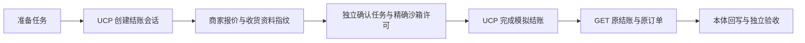

# UCP 官方本地商家接入

2026-10-18。用户选择“先用官方本地测试商家验证”。本轮已把 UCP 结账与订单接入现有 Ontology、Coordinator、Action Runtime 和任务库，并使用独立运行的官方 Python 商家完成实际 HTTP 验证。当前契约为 **ontology-execution-v7／eigos.business@5**，全模型为 **65 个具体类型、2 个接口、23 个函数、10 个决策 Action**。

这里的订单和支付处理器均为本地模拟。没有接通生产商家、Shopify MCP 或 AHA，没有真实资金操作、实际用户 PA 实测或常驻部署。

## 1. 本轮支持的流程



两项能力通过原 `eigos.delegate` 使用；默认目录不登记，只有受信任代码显式注入 `ucpSandbox` 和共用 JobStore 后才可发现。

| 能力 | 输入与行为 | 完成的准确含义 |
| --- | --- | --- |
| `commerce.ucp.prepare.sandbox@1` | 商家商品标识／数量、已配置的测试收货资料；先读发现信息，取得 0 元 reserve 模拟许可，再创建会话 | 请求的结账会话已建立，返回商家当前报价；没有购买或付款 |
| `commerce.ucp.confirm.sandbox@1` | 本用户先前完成的准备任务 ID、明确币种及最小货币单位预算；读取并固定会话，再请求准确许可 | 独立读取的原订单与商品、数量、地址和总额一致；不表示款项到账或配送完成 |

准备与确认是两个明确终点的关联任务。原准备任务的交付物保持历史状态；确认任务引用它取得商家会话，不能任意填写他人的远端 checkout ID。当前不把完整购买目标偷偷降为“创建会话完成”，也不提供自动跨商家搜索或选择商品的能力。

`complete_checkout` 同时可能产生订单和支付效果。计划现在保存受信任动作声明的 `additionalEffects`，该步骤要求 **order 和 payment 两种许可同时具备**；金额、币种、收款方、有效期及计划摘要仍逐项固定，同一步金额只计一次。普通自然语言“同意”不会替代独立授权接口。

## 2. 本体及来源映射

| 对象／函数 | 含义 |
| --- | --- |
| CheckoutRequest | 固定商品标识、整数数量、操作阶段、原准备任务和预算；来源为当前用户任务 |
| CheckoutSession | 商家会话标识、协议版本、状态、清单、总额、报价／地址／买方摘要及已清理的 HTTP 观察 |
| Order、OrderLine、ProductVariant | 复用现有对象；记录原订单引用、当前总额、履约状态及固定商品项，不另建订单执行器 |
| SourceReceipt | 绑定对象属性与业务关系、实际 HTTP 请求／结果摘要和读取时间；证据等级固定为 synthetic |
| checkoutReadiness | 检查商家就绪状态、期限、完整选定地址及业务错误；始终不产生授权 |
| commerceOrderOutcome | 对照原结账检查原订单、清单、费用、地址及预算；有未处理售后调整则保持 unknown |
| PrepareCheckout／CompleteCheckout | 描述业务变更和提交条件的决策 Action；模型调用仍仅生成提案 |

UCP 的 completed 只用于确认结账过程；系统另行 GET 原订单。没有独立支付回执时 **Payment 保持未知，不生成 paid 对象**。订单的 fulfilled 计数或 shipped 事件不等于到达；只有实际 delivered 事件按唯一标识及逐项数量核对后，才形成对应履约判断。重复事件不能重复计算，未来时间不作实际发生证据。

当前来源没有强制的商家版本号，因此保存的是本地主动读取的开始时间、收取时间和响应摘要，不伪造商家 revision。较旧读取不能覆盖较新状态；旧回执保留，当前对象只关联匹配当前内容及关系的证据。取消或租约失效后到达的结果可进入执行账本，但旧领取者不能推进 Task 或投影新业务结果。

## 3. 协议、恢复与边界

本轮固定 **UCP 2026-04-08 REST 子集**，对应官方参考商家声明的版本。已联测发现、Create／Get／Complete Checkout 和 Get Order 的正式路径及报文；Update Checkout 仅有传输方法，未纳入本轮业务流程验证。其他版本拒绝，未声明 Shopify MCP 或完整 UCP 一致性认证。

- 请求使用 RFC 9421 ES256 签名、原始请求体摘要、UCP-Agent、Request-Id 和固定 Idempotency-Key。官方商家开启强制签名校验；未签名读取实测返回 401。
- 只接受显式 `127.0.0.1` 测试端点；发现不能切换来源，HTTP 跳转不跟随。商家交接 URL 也必须属于已固定的本地来源，不从规则猜测 URL。
- 只允许官方模拟支付处理器和固定测试凭据。连接配置不接受真实卡号、钱包令牌或模型指定的支付处理器；生产业务副作用策略仍关闭。
- 同一结账会话固定跨任务的 operationScope，复用现有 ActionIntent 唯一键。第二个任务引用该会话时返回原任务线索；数据库唯一性处理并发竞争，远端 HTTP 使用同一个业务键。
- 下单前再次读取报价。商品、总额、地址或条款变化会停止提交。Complete 响应丢失后，只读原会话和原订单，不重放写入。
- Create 响应丢失且未获得会话 ID 时，当前 UCP 接口没有按该防重键查询的入口；保留 unknown 并交接核对，不猜测 ID 或再次创建。
- 当前仅支持默认计数或 C62／scale=0 的整数商品件数、单个选定配送地址，以及 CNY／USD／EUR 金额；计量单位、复杂分组或售后调整未被支持时明确拒绝或保留 unknown。取消、退款、真实支付委托及生产回调另行实现和授权。

商家配置、签名私钥和完整测试收货资料不进入模型提示或协议交付物。模型读取的是对象、摘要和明确的业务状态。Gateway 与 Worker 仍使用原持久领取、授权、取消、恢复和验收路径，没有新增平行工作流服务。

## 4. 官方商家与真实模型验证

官方源码来自 [Universal-Commerce-Protocol/samples](https://github.com/Universal-Commerce-Protocol/samples)，固定提交 `b7d7a5496d61650e0780f4d1f87684e10f811562`，使用 `rest/python/server` 及其公开花店测试数据。未修改官方业务实现；[启动器](../examples/ucp-reference-merchant.py) 仅限制 loopback、选择独立测试数据库并开启签名校验。参考环境的依赖锁归档为 [reference-uv.lock](evidence/ucp-local-2026-10-18/reference-uv.lock)，未新增 EIGOS 生产依赖。

[验证入口](../examples/verify-ucp-reference.ts) 使用真实本地 A2A 提交两项中文任务，经实际 CodexReasoner／CodexExecutor 查询本体和规划，再通过 MCP 读取同一任务。沙箱许可由验证器按准确动作、金额及收款方批准；这个观察器不代表用户实际 PA。

| 最终阶段 | 模型调用 | 本体读取 | 结果 |
| --- | ---: | ---: | --- |
| 准备会话 | 4 | 5 | completed；参数与目标一致，未创建订单 |
| 确认结账 | 5 | 7 | completed；模型实际调用 checkoutReadiness，准确 order/payment 许可后完成模拟操作及原订单读取 |

最终两项均通过独立验收，A2A 与 MCP 的 taskId、完成状态、artifactId 及数据摘要一致。模型运行对应的 **26 个相关源码文件摘要**与最终实现一致。随后直接读取独立商家数据库：本轮新增 1 个 checkout、1 个 order，玫瑰库存从 996 变为 994；账本、实际 HTTP 和商家防重记录中的操作键一致，两个阶段各只有一次写入。

首轮真实模型在确认阶段暴露了结构化外币预算的重复提取问题：同一 USD 10000 最小货币单位预算被原样重述，却被当成新增文字金额拒绝。修复后原值及来源保持不变；增加预算、换币种或凭文字新增外币金额仍拒绝。首轮失败、中间验证及最终结果均保留在 [证据目录](evidence/ucp-local-2026-10-18/README.md)。

本轮新增 15 项 UCP 集成／反例测试及 1 项结构化预算回归。最终 **304 项测试、类型检查、构建、7 项独立进程 E2E**通过。覆盖缺支付许可、报价变化、响应丢失、原键恢复、重复任务、跨用户访问、错误数量／地址、单位混用、晚到与取消、来源证据变更、跳转、HTTP 200 业务错误及未支持的售后变化。

故障注入使用独立 HTTP 夹具；官方商家进程用于协议互操作、强制签名及独立数据库核验，两者分别记录。

## 5. 复现

在忽略目录取得上述固定提交，把归档的 reference-uv.lock 复制到其 `rest/python/server/uv.lock`，然后在该目录执行 `uv sync --frozen`。使用该目录的 `.venv/bin/python` 启动商家：

```sh
data/ucp-reference/samples/rest/python/server/.venv/bin/python examples/ucp-reference-merchant.py \
  --reference-dir=data/ucp-reference/samples --data-dir=data/ucp-reference/new-merchant --port=61827
```

在另一个终端运行；每次选择新的输出目录以保留原操作身份与记录：

```sh
node --import tsx examples/verify-ucp-reference.ts \
  --merchant=http://127.0.0.1:61827 --output=data/ucp-reference/new-model-run --live
```

`--live` 仅表示真实模型调用，会产生模型用量；商家与支付仍是本地测试。省略该标记使用固定 reasoner 检查协议。结束后关闭测试商家；本轮临时 Gateway、Worker、平台发现服务及官方商家均已关闭。

## 6. 生产接入仍需完成

后续选择正式获准的商家后，需要实现该渠道的认证及签名身份管理、真实用户支付确认、生产来源与权限登记、相应 UCP 版本／传输绑定、回调验证和生产环境验收。Shopify MCP 和 AHA 分别取得正式契约后接入，共用当前业务本体。现有测试许可不升级为真实支付许可，开启配置也不能绕过当前关闭策略。

依据：[UCP Checkout REST](https://ucp.dev/2026-04-08/specification/checkout-rest/)、[Order REST](https://ucp.dev/2026-04-08/specification/order-rest/)、[官方参考商家](https://github.com/Universal-Commerce-Protocol/samples/tree/b7d7a5496d61650e0780f4d1f87684e10f811562/rest/python/server)。
