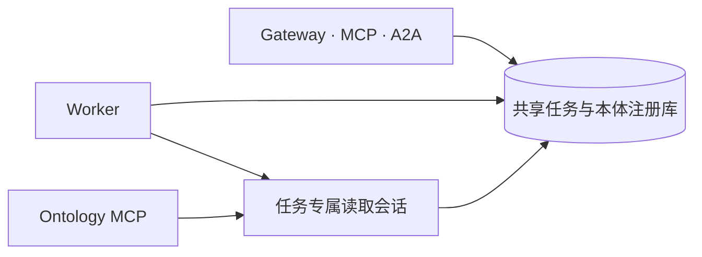

# 共享 Ontology

EIGOS 维护一个运行权威来源：共享业务 SQLite 中的本体注册库。对象类型、关系类型、接口、动作及其发布版本在这里统一解析。Gateway、Worker 和 Ontology MCP 使用同一任务固定的 `ontologyId / releaseId / digest`。



`JobStore.ontologyForJob` 解析任务的准确发布；`OntologyPlanningSession` 限制当前 owner、任务、revision 和可读对象；原生 MCP 包装这个同一会话，不创建另一份本体存储。发布新定义只影响之后选择该版本的任务，不改写旧计划、观察或授权。

## 编辑与发布

| 内容 | 维护位置与用途 |
| --- | --- |
| 受信类型、验证函数和执行实现 | 本模块的 TypeScript；作为编译器及受信运行契约 |
| 供应商工具绑定与证据依赖 | `definitions/*.json`；作为版本化的内核输入 |
| 当前业务定义、草稿与发布 | 共享注册库；通过本体管理接口编辑、校验、发布和激活 |
| 旧版本兼容 | `history/` 的不可变前身和指纹；用于准确历史解释 |
| 构建资源与进程缓存 | `dist/` 和有界只读缓存；自动生成，不手工编辑 |

业务建模流程为创建草稿、修改定义、校验、发布、激活。读取、编辑、发布和对象写入分别鉴权。受管数据动作先生成准确目标与字段预览，经授权后由 Worker 原子提交并回读。详见[本体建模指南](../../docs/guides/ontology-modeling.md)。

受信内核更新保留明确支持的历史定义、校验器和指纹。已有数据库须按实际版本完成兼容检查；缺失准确版本时暂停，不能回退到当前默认模型继续解释旧计划。同步代码或生成资源不会自动证明已有实例已迁移。

当前整合内核为 v21。会员供应商读取线与先前整合候选都曾使用 v20，二者通过准确 digest 区分并保持兼容；它们是旧任务的历史契约，不是两个可独立编辑的当前本体。

## 供应商绑定

| 文件 | 读取范围 |
| --- | --- |
| `definitions/didi-readonly.json` | 地点搜索和车型估价 |
| `definitions/meituan-readonly.json` | 地点、地址及费用预览 |
| `definitions/shopify-catalog.json` | 商品目录和商家端点发现 |

这些声明包含 server、tool、transport、参数来源、观察依赖、评估函数和版本摘要。模型依据实际读取选择动作与顺序；`requires` 表示证据前提，不自动编排调用。连接器只解释选定动作，凭据、主机和允许的外部效果由执行端检查。

```sh
npm run build
npm run ontology:check
npm run ontology:sync
```

编辑声明时递增语义版本并运行验证。同步只把已验证字节复制到 `dist/packages/ontology/definitions/`；运行发布和任务版本仍由注册库管理。旧的根目录 `ontology/` 和 `dist/ontology/` 不再作为加载入口。

`apps/provider-mcp/` 是供应商协议适配层。通用 Ontology MCP 位于协调器的任务会话中，两者不各自保存业务定义。元数据、工具发现、自动测试和进程就绪都不能代替供应商业务回执与独立验收。
