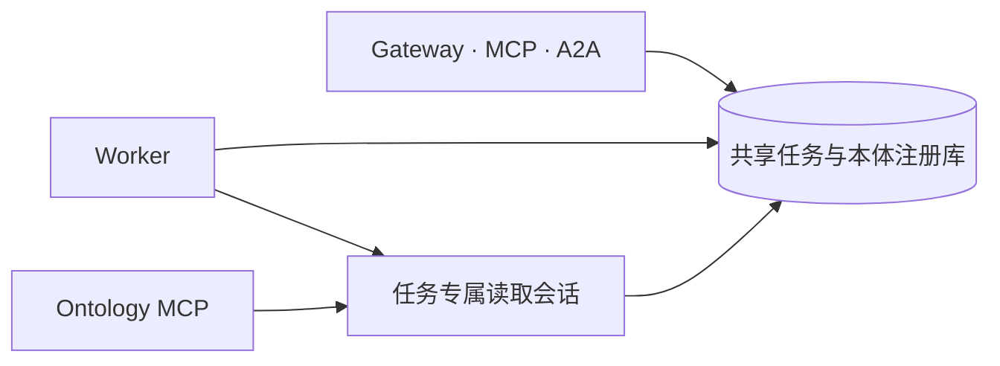

# 共享 Ontology

EIGOS 维护一个运行权威来源：共享业务 SQLite 中的本体注册库。对象类型、关系类型、接口、动作及其发布版本在这里统一解析。Gateway、Worker 和 Ontology MCP 使用同一任务固定的 `ontologyId / releaseId / digest`。



`JobStore.ontologyForJob` 解析任务的准确发布；`OntologyPlanningSession` 限制当前 owner、任务、revision 和可读对象；原生 MCP 包装这个同一会话，不创建另一份本体存储。发布新定义只影响之后选择该版本的任务，不改写旧计划、观察或授权。

## 编辑与发布

| 内容 | 维护位置与用途 |
| --- | --- |
| 受信类型、验证函数和执行实现 | 本模块的 TypeScript；作为编译器及受信运行契约 |
| 供应商工具绑定与证据依赖 | `definitions/*.json`；作为版本化的内核输入 |
| 当前业务定义、草稿与发布 | 共享注册库；通过本体管理接口编辑、校验、发布和激活 |
| 旧版本兼容 | `history/` 的不可变前身和指纹；用于准确历史解释 |
| 构建资源与进程缓存 | `dist/` 和有界只读缓存；自动生成，不手工编辑 |

业务建模流程为创建草稿、修改定义、校验、发布、激活。读取、编辑、发布和对象写入分别鉴权。受管数据动作先生成准确目标与字段预览，经授权后由 Worker 原子提交并回读。详见[本体建模指南](../../docs/guides/ontology-modeling.md)。

[Ontology Pipeline](../../docs/guides/ontology-pipeline.md) 在同一发布中固定服务接入材料和映射引用，保存独立的验证记录，并在发现及派发时检查其当前有效性。来源观察沿既有对象库更新，带来源、时效和任务依赖；历史定义、当前事实、业务权限和完成证据各自保留。

受信内核更新保留明确支持的历史定义、校验器和指纹。已有数据库须按实际版本完成兼容检查；缺失准确版本时暂停，不能回退到当前默认模型继续解释旧计划。同步代码或生成资源不会自动证明已有实例已迁移。

当前代码内核为 v25。v24 的准确构造及任务固定版本保留；个人上下文采用独立的显式升级。v23／v24 的历史构造及指纹保留，v25 为 RequestFact 增加可选的个人事实依据，旧记录不会被重写；数据库当前激活的发布及任务固定版本须分别查询，更新代码不自动激活新本体。会员供应商读取线与先前整合候选都曾使用 v20，二者通过准确 digest 区分并保持兼容。

## 可复用的业务事实

使用者从 `RequestingParty → ServiceRequest` 进入方案、来源观察及验收。实体身份与一次调用分开：地点、酒店、供应商、商品和活动可以由同一 owner 的新来源观察再次引用；估价、参考价格和结账明细保存本次条件与来源证据。复用身份不继承另一任务的权限。

共用语义通过只读接口映射现有属性和关系；规划会话按已知引用批量读取所需事实，合并重复查询并区分缺失、失效与本地分页。活动、旅行和购物使用同一入口，详见[共用属性、关系与任务事实读取](../../docs/guides/shared-ontology-views.md)。

| 来源 | 业务对象与连接 | 事实边界 |
| --- | --- | --- |
| 滴滴读取 | 地点观察 → `Place`；路线 → 起终点；估价观察 → `RideEstimate` → 路线／Provider | 原生接口只给地点内容摘要；完全相同的来源地点可复用，名称或坐标变化不推断为同一地点。车型金额可筛选，完整费用未知。 |
| RollingGo | 搜索观察 → `HotelProperty`／`HotelPrice`；参考价 → 酒店／Provider／请求 | 酒店身份使用原生 hotelId。价格固定入住日期、晚数、人数和返回币种，不猜测按晚还是全程，也不制造房型或库存。 |
| 美团读取 | 观察 → 地点／配送报价；报价 → 包裹、路线、提供者及请求 | 有原生 POI ID 时按来源及城市限定；没有时仅复用同一内容指纹。私密地址不从公开地点推断。 |
| 免费报名 | 观察 → `Event`；报名观察 → `EventRegistration` → 活动；请求 → 报名 | 报名身份限定来源、活动和参与者；独立回读与状态分开，未知场地不补造，参与者不等同于委托账户。 |
| Shopify 结账 | 观察 → `CheckoutItem` → 目录同一 `ProductVariant`／Provider／请求 | 明细固定数量、价格和规格版本。结账读取不覆盖已有更完整的商品规格，不创建 Order 或 Payment。 |

`businessFactStatus` 核对车型估价、酒店参考价、报名和结账明细的来源、关系、时效、请求及关联对象版本。它只证明当前观察可用，不代表用户目标已完成或产生执行权限。稳定实体的历史观察仍保留；变更后旧价格或报名不能继续套用新规格、酒店描述或活动时间。

源实体无语义变化时可保留 revision；新任务的独立读取仍单独记录来源与输入依赖。不能通过实体复用绕过来源撤销、字段限制或跨 owner 隔离。源字段与关系的接入约束见 [Pipeline 指南](../../docs/guides/ontology-pipeline.md)。

## 供应商绑定

| 文件 | 读取范围 |
| --- | --- |
| `definitions/didi-readonly.json` | 地点搜索和车型估价 |
| `definitions/meituan-readonly.json` | 地点、地址及费用预览 |
| `definitions/shopify-catalog.json` | 商品目录和商家端点发现 |

这些声明包含 server、tool、transport、参数来源、观察依赖、评估函数和版本摘要。模型依据实际读取选择动作与顺序；`requires` 表示证据前提，不自动编排调用。连接器只解释选定动作，凭据、主机和允许的外部效果由执行端检查。

```sh
npm run build
npm run ontology:check
npm run ontology:sync
```

编辑声明时递增语义版本并运行验证。同步只把已验证字节复制到 `dist/packages/ontology/definitions/`；运行发布和任务版本仍由注册库管理。旧的根目录 `ontology/` 和 `dist/ontology/` 不再作为加载入口。

`apps/provider-mcp/` 是供应商协议适配层。通用 Ontology MCP 位于协调器的任务会话中，两者不各自保存业务定义。元数据、工具发现、自动测试和进程就绪都不能代替供应商业务回执与独立验收。

个人服务对象、具名业务关系、默认值选择及受控更新见[Person 与跨任务个人上下文](../../docs/guides/person-context.md)。
