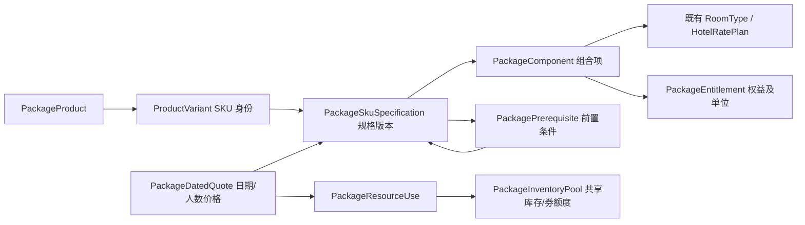

# 合成酒店套餐 Ontology 与优化器

这是独立、无网络、只读的测试算法。它使用真实的 `OntologyModel` 和 `OntologyObjectStore`，运行在 `eigos.synthetic.hotel-packages` 测试命名空间，不改变当前生产内核、不发布或激活正式本体，也不注册线上 MCP/A2A 能力。所有输入和输出均为 synthetic，`bookable=false`、`executed=false`。



Pipeline 未来将有权限的真实来源映射为这些实体/规格/观察，再交给优化函数；Pipeline 字段映射本身不负责价格求解。当前没有真实 SKU、房型或库存映射，不能把搜索起价、营销文字或体验模式响应直接送入测试工厂并声称获得真实最优价。

## 运行

```sh
node --import tsx packages/ontology/hotel-package-optimization/demo.ts
node --import tsx --test tests/hotel-package-optimizer*.test.ts
```

演示金额均为合成：同酒店、同房型和人数下，房间 599 元、早餐 60 元、晚餐 120 元、套餐 699 元。需要晚餐时套餐比拆买 779 元便宜；只需早餐时拆买 659 元更便宜。

## 算法与状态

1. 通过拥有权限制的普通本体读取取得请求、酒店、房型、SKU 规格、组件、日期报价、库存池和前置关系，固定内容/版本/关系快照。
2. 生成按房间、连续日期及可选权益确定的候选实现；明确每晚和每次入住的权益数量，不为未使用权益抵现金。共享房型或房价计划不产生新的物理房型。
3. 进行有界组合搜索与分支限界，覆盖住宿/权益需求，并验证总预算、购买数量、共享库存、券额度、房型连续性和前置购买/激活/兑换关系。价格用币种最小单位 `BigInt` 精确计算。
4. 返回最便宜的几个可行路径、逐项价格、需求覆盖、库存用量和拒绝/未知原因。一次性门槛费按实际所选 SKU 计价，平台佣金不抵用户支出。

`optimal` 仅表示完整搜索已穷尽所提供的完整合成日期报价目录，且没有未知候选；并非全市场最优。目录完整性是对本次候选报价范围的明确声明，不代表引擎会补查商品其它潜在日期/房型价格；相关 SKU 没有日期报价时仍标为 unknown。目录不完整、价格/规格/库存/条款未知或工作界限触发时，只返回 `best_known` 或 `inconclusive`。完整目录内确定无解时返回 `no_solution`。

前置条件表达所需资格/持有数量，`per_plan` 可复用，`per_unit` 随从属购买数量增加；它们不消耗前置 SKU。可消耗的优惠券和库存由共享资源池独立限制。`scope` 与日期条件决定前置资格适用于哪个房间/日期，`phase` 区分只需购买还是需先完成激活/预约兑换。没有需求收益的门槛购买只在请求明确允许 `allowQualificationPurchases` 时参与。

## 验证

`verifySyntheticHotelPackagePlan` 不调用 DFS 或候选生成器，重新读取当前本体并独立计算价格、权益覆盖、资源消耗和步骤前置关系；篡改结果、来源变化、价格/库存过期或权限不可读均拒绝。它验证可行性与总价，**不重放全搜索证明最优性**（`optimalityReplayed=false`）。最优性另由独立的完整子集穷举 oracle 对 30 个小目录交叉验证。

## 第一版边界

- 同一酒店、1–7 晚、1–4 间房；一个可购买的住宿 SKU 单位仅支持一间连续住宿组件。多间房组合由多个单位覆盖；来源多房间单位或未知晚数会保持 unknown，不强行拆分。
- 支持明确的可选房型、每晚/每入住/每套餐权益、即时客户折扣、有限券额度、固定前置购买成本，以及日期报价给定的必须费用。未定义的阶梯价、跨商家合单、跨酒店换住和退款价值模型尚未支持。
- `allowSplitStay=false` 要求一个单位覆盖该房间整个住宿期；允许拆单也不证明酒店能提供同一物理房间或合并预约。
- 可选权益仅是已含在固定套餐价中的兑换选择；付费附加服务应作为另一个明确报价 SKU。
- 合成工厂的默认值有意构造“已知”的假设，不能用于采纳供应商数据。正式使用仍需来源映射、权限、资格和独立日期验价/验库存。
